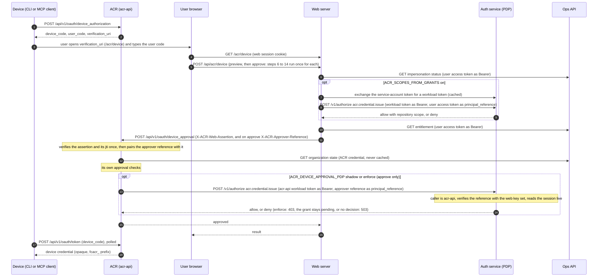
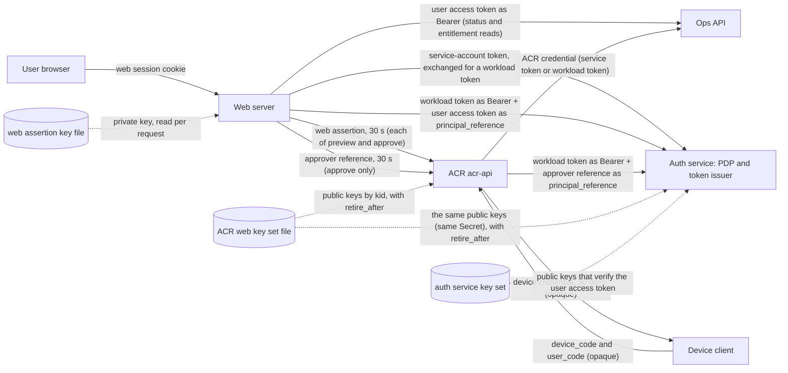

# ACR device approval

This page shows how a device (a command line tool or an MCP client) gets an ACR credential after a
person approves it in the web app, which parts take part, which signed tokens and keys move between
them, and what ACR itself checks. It states what the code does on <date of the merge>. The web side (the
approver decision, the switch that turns it on, the refusal texts and rollback) is in the web
repository's `docs/auth-acr-device-approval.md`. The diagram source sits next to the code in
`internal/auth/device-approval-architecture.md`; change both together.

## 1. Overview

- The device starts the grant at ACR and gets a user code. It has no browser session.
- The person opens the web approval page, signs in to web, and types the user code. On this path the
  browser makes no ACR call and holds no ACR credential. It holds only the web session cookie.
- Web reads the Ops impersonation status and the entitlement and, when `ACR_SCOPES_FROM_GRANTS` is
  on, asks the policy decision point (PDP) whether this person may issue an ACR credential.
- Web signs a short assertion and, for an approval, a second short token, the approver reference, and
  sends the approval to ACR. ACR verifies the assertion, checks that the approver reference belongs to
  that assertion, applies its own approval checks and reads the organization state from Dev Health.
  While `ACR_DEVICE_APPROVAL_PDP` is `shadow` or `enforce`, ACR then asks the PDP about the approver,
  with the approver reference as the principal. Then it marks the grant approved.
- The device polls ACR with its device code and receives the device credential.
- Preview and approve are two calls. Each one repeats the reads, the decision and a fresh assertion.

## 2. Sequence

## 3. Components, tokens and keys

Signed and opaque tokens on this path (the sources are in the diagram source file):

| Token                                                      | Signer                                                       | Verifier                                                                                             | Audience                                                                 | Lifetime                                                                          |
| ---------------------------------------------------------- | ------------------------------------------------------------ | ---------------------------------------------------------------------------------------------------- | ------------------------------------------------------------------------ | --------------------------------------------------------------------------------- |
| Web session cookie (sealed Auth.js session)                | web, sealed with `AUTH_SECRET` or `NEXTAUTH_SECRET`          | web                                                                                                  | none                                                                     | no `maxAge` is set in the web auth code, so the Auth.js default applies (30 days) |
| Refresh credential (`dhr1_` prefix, opaque, single use)    | auth service                                                 | auth service                                                                                         | none                                                                     | 7 days                                                                            |
| User access token (EdDSA, `at+jwt`)                        | auth service                                                 | PDP (as `principal_reference`) and Ops API (status and entitlement reads)                            | `dev-health-api`                                                         | at most 60 minutes (setting: 5 to 60)                                             |
| Service-account token (Kubernetes, projected into the pod) | Kubernetes cluster                                           | auth service, by a TokenReview at the exchange route                                                 | set by the deployment                                                    | set by the deployment                                                             |
| Workload token (`workload+jwt`)                            | auth service, by exchange of the service-account token       | PDP route `/v1/authorize`, for admitted callers only (web; acr-api for the approver decision)        | `auth-service`                                                           | at most 300 s, cached and renewed at half life                                    |
| Web assertion (EdDSA, `JWT`, with `kid`)                   | web, one Ed25519 key file                                    | ACR                                                                                                  | `ACR_WEB_ASSERTION_AUDIENCE` (ACR compares)                              | 30 s, with 5 s clock skew                                                         |
| Approver reference (EdDSA, `web-approver+jwt`, with `kid`) | web, the same key file as the web assertion, on approve only | ACR (pair check against the web assertion) and the PDP (as `principal_reference`, from acr-api only) | `auth-service` (told apart from the workload token by `typ` and key set) | 30 s, with 5 s clock skew; never longer than its web assertion                    |
| ACR credential for Ops (service token, or workload token)  | Ops (service token, opaque) or auth service (workload token) | Ops API                                                                                              | none (service token) or `dev-health-api` (workload token)                | set by Ops (service token) or at most 300 s (workload token)                      |
| Device code and user code                                  | ACR (opaque, not signed)                                     | ACR (stored as hashes)                                                                               | none                                                                     | 10 minutes                                                                        |
| Device credential (`fcacr_` prefix)                        | ACR (opaque, not signed)                                     | ACR on later calls                                                                                   | none                                                                     | 30 days                                                                           |

Keys (names only; no key value is ever written in a document):

| Key                                                                                                                    | Held by                                                                                  | Used for                                                                                                                              |
| ---------------------------------------------------------------------------------------------------------------------- | ---------------------------------------------------------------------------------------- | ------------------------------------------------------------------------------------------------------------------------------------- |
| Web assertion signing key (Ed25519 private key file; `ACR_WEB_ASSERTION_KEY_FILE`, `kid` from `ACR_WEB_ASSERTION_KID`) | web                                                                                      | signs the web assertion; read on every request                                                                                        |
| ACR web key set (JWKS file; `ACR_WEB_ASSERTION_JWKS_FILE`; each key has a `kid` and may have `retire_after`)           | ACR, and the auth service from the same Secret (`AUTH_AUTHORIZE_WEB_APPROVER_JWKS_FILE`) | verifies the web assertion (ACR) and the approver reference (ACR and the PDP); a key verifies only while now is before `retire_after` |
| Auth service key set (published)                                                                                       | auth service signs; the PDP verifies with the published keys                             | user access token at the PDP (`principal_reference`)                                                                                  |

Settings that change this picture, with the production value on 2026-11-11 (read from the production
deploy values):

| Setting                                                       | Where        | Default         | Production on 2026-11-11 | Effect                                                                                                                                                                                        |
| ------------------------------------------------------------- | ------------ | --------------- | ------------------------ | --------------------------------------------------------------------------------------------------------------------------------------------------------------------------------------------- |
| `ACR_SCOPES_FROM_GRANTS`                                      | web          | off             | on (`true`)              | with it on, the PDP decides the approval (the approver decision)                                                                                                                              |
| `ACR_OAUTH_ISSUER`                                            | web          | unset           | unset                    | set: `sid` and `impersonating` are signed into the assertion and the first-party browser OAuth client is on; unset: neither                                                                   |
| `ACR_DEV_HEALTH_ENTITLEMENT_CREDENTIAL`                       | ACR          | `workload`      | `workload`               | the credential ACR presents to Ops for the organization state read                                                                                                                            |
| `ACR_DEVICE_APPROVAL_PDP`                                     | ACR          | `off`           | <read at the roll>       | `shadow`: ACR asks the PDP about the approver and only records it; `enforce`: a deny or a missing approver reference is 403, no decision is 503; an unknown value is `off` with an ERROR line |
| `AUTH_AUTHORIZE_WEB_APPROVER_ISSUER`, `_JWKS_FILE`, `_CALLER` | auth service | unset           | <read at the roll>       | all three set and the caller admitted: the PDP accepts the approver reference from acr-api; otherwise it refuses it, with one ERROR line when only some are set                               |

## 4. What ACR checks at approval

ACR checks the approval itself (and, with `ACR_DEVICE_APPROVAL_PDP` on, then asks the PDP; section 6):

- it refuses an impersonating principal;
- it reads the organization state from Dev Health on each approval, never from a cache, and refuses
  an organization that is gone or disabled;
- it requires the organization hint of the pending request to match;
- it requires the requested repositories to lie within the grant of the principal: `["*"]` only for
  a principal whose grant is `["*"]`, named repositories only within the grant.

## 5. Why web is in the path

The web assertion is not new work. It dates from mid-July 2026. Device approval was built on it in
late July 2026, and OAuth consent has used it since 22 September 2026: the consent approval is also
a web call to ACR that carries the assertion. The plan of record for authorization keeps this
request-bound assertion for web context, evidence and approval calls.

Web is in the path because, on the device approval path, the browser makes no ACR call and holds no
ACR credential. ACR learns that a signed-in person approves this code for this organization and
these repositories from a statement signed by web.

A first-party browser OAuth client of ACR exists in code (a browser-class credential with a refresh
grant). It is on only when `ACR_OAUTH_ISSUER` is set on web, and production does not set it on
2026-11-11. Approving a device with the browser's own ACR token is not built.

What would replace the web assertion on this path: the browser calls ACR itself with an OAuth 2.1
token that the auth service issues, bound to the user and the session. Then web is no proxy here and
the approval assertion can go. That path is planned and is not built on 2026-11-11.

Until then, with `ACR_SCOPES_FROM_GRANTS` on, web's own PDP decision is the control on this path. ACR
applies its own checks (section 4), and with `ACR_DEVICE_APPROVAL_PDP` on it asks the PDP itself
(section 6). That check is defence in depth, not a replacement for the decision in web.

For that check web signs a second token. ACR holds no user credential at approval, and the PDP takes
only a verified principal reference, never a principal that a caller names. So web signs, with the
same key, a short approver reference for the PDP, and ACR forwards only that token. It holds no
repository list, so its size stays the same for every approval. When the browser approves with its
own ACR token, the web assertion, the approver reference and the PDP kind that reads it all go.

## 6. The approver decision in ACR

While `ACR_DEVICE_APPROVAL_PDP` is `shadow` or `enforce`, a device approval and a consent approve
also carry `X-ACR-Approver-Reference`, and ACR asks the PDP about the approver once.

- Web signs the reference with the web assertion key: `typ` `web-approver+jwt`, audience
  `auth-service`, 30 s, claims `sub`, `org_id`, `sid`, `impersonating`, `action`
  (`acr.credential.issue`) and `req`, the SHA-256 of the exact web assertion it travels with. `sid` is
  the session id of web's own Ops access token, so the reference has one even while `ACR_OAUTH_ISSUER`
  is unset. A reference longer than 1000 characters is not signed, and web logs one ERROR line at start
  when its issuer and `kid` could make one.
- ACR pairs it with the web assertion: the same key rules, `req` over that assertion, the same `sub`,
  `org_id` and `impersonating`, the assertion's `sid` when it has one, and the reference never outlives
  the assertion. The pair and the assertion's own once-only `jti` bind the reference to one approval.
- After its own checks and before it stores the approval, ACR sends `POST /v1/authorize` with its
  workload token, the reference as `principal_reference` and `acr.credential.issue` on the
  organization. Poll and redeem never ask.
- The PDP takes the reference only from acr-api, and acr-api may present no other kind. It verifies
  the reference with the same public key set as ACR, reads the session live on every call (never from
  a cache), and answers only `acr.credential.issue` on the reference's own organization.
- At the PDP the reference is not specific to one approval: for at most 35 s it proves only that the
  user's session is live and may issue in the organization. A second ask in that time gets the same
  answer and no more power.
- `enforce`: a deny, a missing reference or one that does not pair is 403 `access_denied`, and the
  grant stays pending; no decision (outage, timeout, rate limit) is 503. `shadow` asks and records the
  outcome in the line `device approval decision` and the counter
  `acr_device_approval_decisions_total`, and never refuses. ACR logs the mode in effect at start
  (`device approval decision mode`).
