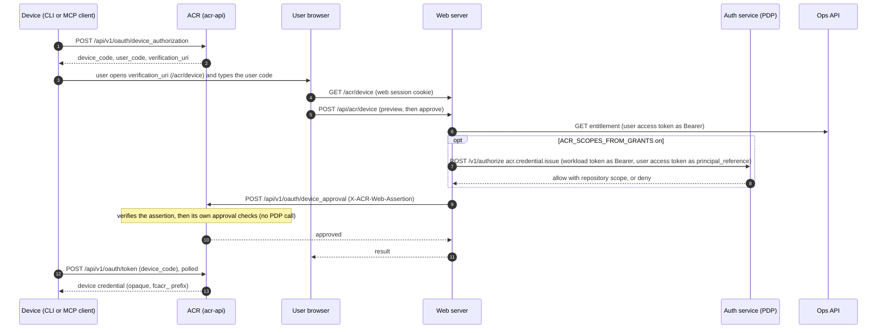
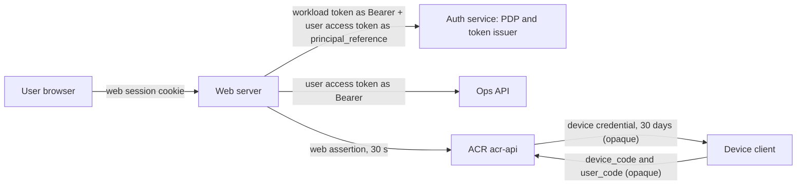

# ACR device approval

This page shows how a device (a command line tool or an MCP client) gets an ACR credential after a
person approves it in the web app, which parts take part, which signed tokens move between them, and
what ACR itself checks. It states what the code does on 2026-11-11. The web side (the approver
decision, the switch that turns it on, the refusal texts and rollback) is in the web repository's
`docs/auth-acr-device-approval.md`. The diagram source sits next to the code in
`internal/auth/device-approval-architecture.md`; change both together.

## 1. Overview

- The device starts the grant at ACR and gets a user code. It has no browser session.
- The person opens the web approval page, signs in to web, and types the user code. The browser holds
  only the web session cookie. It never holds an ACR credential.
- Web checks entitlement with Ops and, when its grants switch is on, asks the policy decision point
  (PDP) whether this person may issue an ACR credential.
- Web signs a short assertion and sends the approval to ACR. ACR verifies the assertion, applies its
  own approval checks and marks the grant approved. ACR does not call the PDP for the approval.
- The device polls ACR with its device code and receives the device credential.

## 2. Sequence

## 3. Components and tokens

| Token                                    | Signer                                                       | Verifier                                                      | Audience                                    | Lifetime                              |
| ---------------------------------------- | ------------------------------------------------------------ | ------------------------------------------------------------- | ------------------------------------------- | ------------------------------------- |
| Web session cookie                       | web (Auth.js)                                                | web                                                           | none                                        | not part of this flow                 |
| User access token (EdDSA, `at+jwt`)      | auth service                                                 | PDP (as `principal_reference`) and Ops API (entitlement read) | `dev-health-api`                            | at most 60 minutes (setting: 5 to 60) |
| Workload token (`workload+jwt`)          | auth service, by exchange of the pod's service-account token | PDP route `/v1/authorize`, for admitted callers only          | `auth-service`                              | at most 300 s                         |
| Web assertion (EdDSA, `JWT`, with `kid`) | web, one Ed25519 key file                                    | ACR                                                           | `ACR_WEB_ASSERTION_AUDIENCE` (ACR compares) | 30 s, with 5 s clock skew             |
| Device code and user code                | ACR (opaque, not signed)                                     | ACR (stored as hashes)                                        | none                                        | 10 minutes                            |
| Device credential (`fcacr_` prefix)      | ACR (opaque, not signed)                                     | ACR on later calls                                            | none                                        | 30 days                               |

`sid` and `impersonating` are signed into the assertion only when `ACR_OAUTH_ISSUER` is set on web.
Without it the assertion carries neither, and ACR treats `sid` as optional.

## 4. What ACR checks at approval

On 2026-11-11 ACR checks the approval itself and does not call the PDP:

- it refuses an impersonating principal;
- it refuses an organization that is gone or disabled;
- it requires the organization hint of the pending request to match;
- it requires the requested repositories to lie within the grant of the principal: `["*"]` only for
  a principal whose grant is `["*"]`, named repositories only within the grant.

## 5. Why web is in the path

The web assertion is not new work. It dates from mid-July 2026. Device approval was built on it in
late July 2026, and OAuth consent has used it since 22 September 2026. The plan of record for
authorization keeps this request-bound assertion for web context, evidence and approval calls.

Web is in the path because ACR holds no credential from the browser. The browser has the web session
cookie only, and ACR has no user session of its own. The one way ACR learns that a signed-in person
approves this code for this organization and these repositories is a statement signed by web.

What would replace it: the browser calls ACR itself with an OAuth 2.1 token that the auth service
issues, bound to the user and the session. Then web is no proxy on this path and the approval
assertion can go. That path is planned and is not built on 2026-11-11.

Until then, with its grants switch on, web's own PDP decision is the control on this path. ACR applies its own checks
(section 4). A PDP check inside ACR would be defence in depth, not a replacement for the decision in
web.
