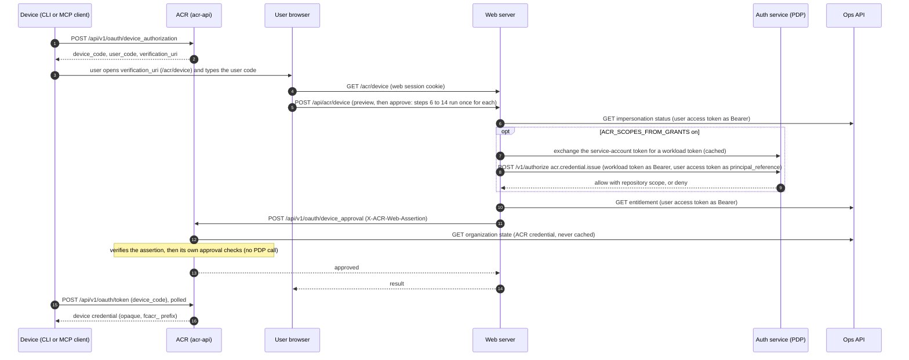
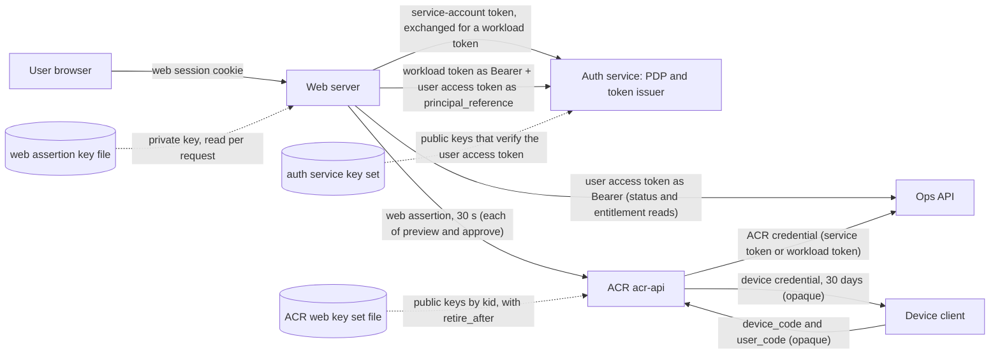

# ACR device approval

This page shows how a device (a command line tool or an MCP client) gets an ACR credential after a
person approves it in the web app, which parts take part, which signed tokens and keys move between
them, and what ACR itself checks. It states what the code does on 2026-11-11. The web side (the
approver decision, the switch that turns it on, the refusal texts and rollback) is in the web
repository's `docs/auth-acr-device-approval.md`. The diagram source sits next to the code in
`internal/auth/device-approval-architecture.md`; change both together.

## 1. Overview

- The device starts the grant at ACR and gets a user code. It has no browser session.
- The person opens the web approval page, signs in to web, and types the user code. On this path the
  browser makes no ACR call and holds no ACR credential. It holds only the web session cookie.
- Web reads the Ops impersonation status and the entitlement and, when `ACR_SCOPES_FROM_GRANTS` is
  on, asks the policy decision point (PDP) whether this person may issue an ACR credential.
- Web signs a short assertion and sends the approval to ACR. ACR verifies the assertion, applies its
  own approval checks, reads the organization state from Dev Health and marks the grant approved. ACR
  does not call the PDP for the approval.
- The device polls ACR with its device code and receives the device credential.
- Preview and approve are two calls. Each one repeats the reads, the decision and a fresh assertion.

## 2. Sequence

## 3. Components, tokens and keys

Signed and opaque tokens on this path (the sources are in the diagram source file):

| Token                                                      | Signer                                                       | Verifier                                                                  | Audience                                                  | Lifetime                                                                          |
| ---------------------------------------------------------- | ------------------------------------------------------------ | ------------------------------------------------------------------------- | --------------------------------------------------------- | --------------------------------------------------------------------------------- |
| Web session cookie (sealed Auth.js session)                | web, sealed with `AUTH_SECRET` or `NEXTAUTH_SECRET`          | web                                                                       | none                                                      | no `maxAge` is set in the web auth code, so the Auth.js default applies (30 days) |
| Refresh credential (`dhr1_` prefix, opaque, single use)    | auth service                                                 | auth service                                                              | none                                                      | 7 days                                                                            |
| User access token (EdDSA, `at+jwt`)                        | auth service                                                 | PDP (as `principal_reference`) and Ops API (status and entitlement reads) | `dev-health-api`                                          | at most 60 minutes (setting: 5 to 60)                                             |
| Service-account token (Kubernetes, projected into the pod) | Kubernetes cluster                                           | auth service, by a TokenReview at the exchange route                      | set by the deployment                                     | set by the deployment                                                             |
| Workload token (`workload+jwt`)                            | auth service, by exchange of the service-account token       | PDP route `/v1/authorize`, for admitted callers only                      | `auth-service`                                            | at most 300 s, cached and renewed at half life                                    |
| Web assertion (EdDSA, `JWT`, with `kid`)                   | web, one Ed25519 key file                                    | ACR                                                                       | `ACR_WEB_ASSERTION_AUDIENCE` (ACR compares)               | 30 s, with 5 s clock skew                                                         |
| ACR credential for Ops (service token, or workload token)  | Ops (service token, opaque) or auth service (workload token) | Ops API                                                                   | none (service token) or `dev-health-api` (workload token) | set by Ops (service token) or at most 300 s (workload token)                      |
| Device code and user code                                  | ACR (opaque, not signed)                                     | ACR (stored as hashes)                                                    | none                                                      | 10 minutes                                                                        |
| Device credential (`fcacr_` prefix)                        | ACR (opaque, not signed)                                     | ACR on later calls                                                        | none                                                      | 30 days                                                                           |

Keys (names only; no key value is ever written in a document):

| Key                                                                                                                    | Held by                                                      | Used for                                                                           |
| ---------------------------------------------------------------------------------------------------------------------- | ------------------------------------------------------------ | ---------------------------------------------------------------------------------- |
| Web assertion signing key (Ed25519 private key file; `ACR_WEB_ASSERTION_KEY_FILE`, `kid` from `ACR_WEB_ASSERTION_KID`) | web                                                          | signs the web assertion; read on every request                                     |
| ACR web key set (JWKS file; `ACR_WEB_ASSERTION_JWKS_FILE`; each key has a `kid` and may have `retire_after`)           | ACR                                                          | verifies the web assertion; a key verifies only while now is before `retire_after` |
| Auth service key set (published)                                                                                       | auth service signs; the PDP verifies with the published keys | user access token at the PDP (`principal_reference`)                               |

Settings that change this picture, with the production value on 2026-11-11 (read from the production
deploy values):

| Setting                                 | Where | Default         | Production on 2026-11-11 | Effect                                                                                                                      |
| --------------------------------------- | ----- | --------------- | ------------------------ | --------------------------------------------------------------------------------------------------------------------------- |
| `ACR_SCOPES_FROM_GRANTS`                | web   | off             | on (`true`)              | with it on, the PDP decides the approval (the approver decision)                                                                        |
| `ACR_OAUTH_ISSUER`                      | web   | unset           | unset                    | set: `sid` and `impersonating` are signed into the assertion and the first-party browser OAuth client is on; unset: neither |
| `ACR_DEV_HEALTH_ENTITLEMENT_CREDENTIAL` | ACR   | `service_token` | `workload`               | the credential ACR presents to Ops for the organization state read                                                          |

## 4. What ACR checks at approval

On 2026-11-11 ACR checks the approval itself and does not call the PDP:

- it refuses an impersonating principal;
- it reads the organization state from Dev Health on each approval, never from a cache, and refuses
  an organization that is gone or disabled;
- it requires the organization hint of the pending request to match;
- it requires the requested repositories to lie within the grant of the principal: `["*"]` only for
  a principal whose grant is `["*"]`, named repositories only within the grant.

## 5. Why web is in the path

The web assertion is not new work. It dates from mid-July 2026. Device approval was built on it in
late July 2026, and OAuth consent has used it since 22 September 2026: the consent approval is also
a web call to ACR that carries the assertion. The plan of record for authorization keeps this
request-bound assertion for web context, evidence and approval calls.

Web is in the path because, on the device approval path, the browser makes no ACR call and holds no
ACR credential. ACR learns that a signed-in person approves this code for this organization and
these repositories from a statement signed by web.

A first-party browser OAuth client of ACR exists in code (a browser-class credential with a refresh
grant). It is on only when `ACR_OAUTH_ISSUER` is set on web, and production does not set it on
2026-11-11. Approving a device with the browser's own ACR token is not built.

What would replace the web assertion on this path: the browser calls ACR itself with an OAuth 2.1
token that the auth service issues, bound to the user and the session. Then web is no proxy here and
the approval assertion can go. That path is planned and is not built on 2026-11-11.

Until then, with `ACR_SCOPES_FROM_GRANTS` on, web's own PDP decision is the control on this path. ACR
applies its own checks (section 4). A PDP check inside ACR would be defence in depth,
not a replacement for the decision in web.
