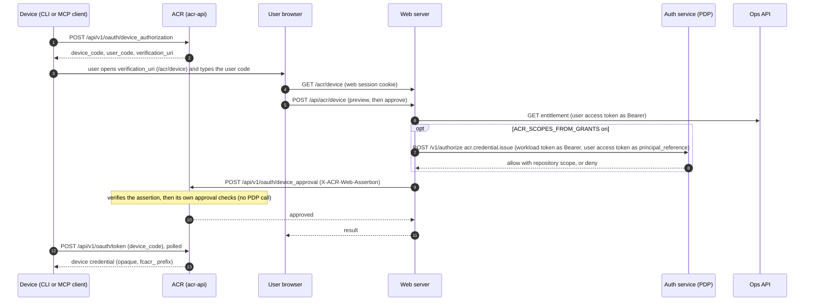
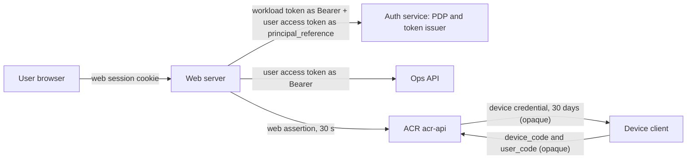

# ACR device approval: diagram source

The public page [docs/device-approval.md](../../docs/device-approval.md) copies the two diagrams below.
This file is the source: change both together. The web repository holds the same diagrams and token
rows in `src/lib/acr/device-approval-architecture.md`; the two copies are byte-equal. Facts are pinned to web
`dea85d0ae0d3`, acr `3c48c78b9b8f` and ops `cfeabc7f4cd1` (2026-11-11). Examples hold names only, never
a key, token or code value.

Entry points here: `internal/auth/web_assertion.go` (the verifier of the web assertion),
`internal/api/device_routes.go` (the device approval handler), `internal/auth/device_flow.go`
(the approval checks).

## Sequence

## Components and tokens

## Token rows

| Token                                   | Signer                                                                          | Verifier                                                        | Audience                                                                      | Lifetime                                        | Source                                                                                                                                                                                                                                                                                                                                                                                           |
| --------------------------------------- | ------------------------------------------------------------------------------- | --------------------------------------------------------------- | ----------------------------------------------------------------------------- | ----------------------------------------------- | ------------------------------------------------------------------------------------------------------------------------------------------------------------------------------------------------------------------------------------------------------------------------------------------------------------------------------------------------------------------------------------------------ |
| Web session cookie                      | web (Auth.js)                                                                   | web                                                             | none                                                                          | not part of this flow                           | web `tests/acr-secret-boundary.spec.ts` (the browser holds no ACR credential)                                                                                                                                                                                                                                                                                                                    |
| User access token (EdDSA, `typ` at+jwt) | auth service                                                                    | PDP for `principal_reference`; Ops API for the entitlement read | `dev-health-api`                                                              | at most 60 min (default 60, 5 to 60 by setting) | ops `internal/auth/authapi/issuer_eddsa.go:24`; ops `internal/auth/authapi/authorize_reference.go:91-131` (PDP verifier, audience `dev-health-api`); ops `internal/auth/contracts/access_token.go:14,18`; ops `internal/auth/authconfig/config.go:108-110`; web `src/lib/acr/ops.ts:128,171` (Bearer on the entitlement read); web `src/lib/acr/grantScopes.ts:79,174` (as `principalReference`) |
| Workload token (`typ` workload+jwt)     | auth service, by RFC 8693 exchange of the pod's projected service-account token | PDP route `/v1/authorize`, admitted callers only                | `auth-service`                                                                | at most 300 s, refreshed at half life           | web `src/lib/auth/workload/token.ts:11-14,110,171`; web `src/lib/auth/authorize/transport.ts:24` (Bearer); ops `internal/auth/contracts/workload_token.go:13`; ops `internal/auth/authruntime/authorize.go:33-34` (caller gate `AUTH_AUTHORIZE_CALLER_SUBJECTS`)                                                                                                                                 |
| Web assertion (EdDSA, `typ` JWT, `kid`) | web, one Ed25519 key file                                                       | ACR (`WebAssertionVerifier`)                                    | `ACR_WEB_ASSERTION_AUDIENCE` (ACR compares it to its own configured audience) | 30 s (`exp = iat + 30`), 5 s clock skew         | web `src/lib/acr/assertion.ts:52-60`; acr `internal/auth/web_assertion.go:23-24,158,209-217` (lifetime, skew, issuer and audience compare, replay record)                                                                                                                                                                                                                                        |
| Device code and user code               | ACR                                                                             | ACR (stored as hashes)                                          | none (opaque, not signed)                                                     | 10 min                                          | acr `internal/storage/device_authorization.go:18`; acr `internal/auth/device_poll.go:109`; web `src/app/acr/device/page.tsx` (8-character user code pattern)                                                                                                                                                                                                                                     |
| Device credential (`fcacr_` prefix)     | ACR (opaque, not signed)                                                        | ACR on later calls                                              | none                                                                          | 30 days                                         | acr `internal/auth/types.go:23`; acr `internal/auth/device_flow.go:19`; acr `internal/auth/device_poll.go:174`                                                                                                                                                                                                                                                                                   |

`sid` and `impersonating` are signed into the assertion only when `ACR_OAUTH_ISSUER` is set on web
(`src/lib/acr/config.ts:160-161`, `src/lib/acr/service.ts:261`). The deploy values for production web
set no `ACR_OAUTH_ISSUER` on 2026-11-11, so production assertions carry no `sid`; ACR treats `sid` as
optional (`acr internal/auth/web_assertion.go:91-94`).

## History (ids and dates; the public page has dates and words only)

- The web assertion: acr #24 (merged 2026-07-15) and web #785 (merged 2026-07-16), under CHAOS-2911.
- Device approval on it: web #806 (merged 2026-07-26, CHAOS-3096) and acr #52 (merged 2026-07-27).
- OAuth consent on it: acr #638 (merged 2026-09-22, CHAOS-6226).
- The Wave 9 epic (CHAOS-3282, created 2026-07-30) keeps the request-bound assertion for web
  context, evidence and approval calls.
- Replacement path: the browser calls ACR itself with an OAuth 2.1 token bound to user and session
  (CHAOS-12069 ruling D6525; CHAOS-12082 train). Planned, not built on 2026-11-11.
