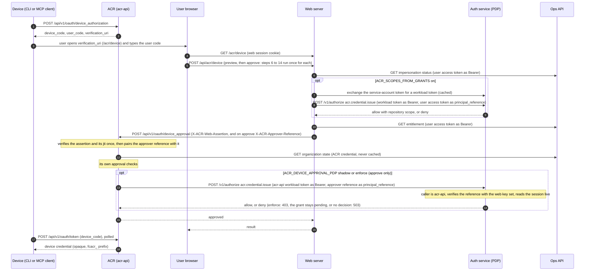
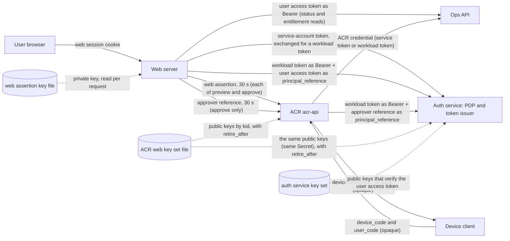

# ACR device approval: diagram source

The public page [docs/device-approval.md](../../docs/device-approval.md) copies the two diagrams and the
first columns of the token, key and setting tables below. This file is the source: change both together
(a test compares them). The web repository holds the same diagrams and rows in
`src/lib/acr/device-approval-architecture.md`; the two copies are byte-equal below this paragraph. Facts are
pinned to web `dea85d0ae0d3`, acr `3c48c78b9b8f`, ops `cfeabc7f4cd1` and deploy `2e54677e3f81` (2026-11-11).
Examples hold names only, never a key, token or code value.

Entry points here: `internal/auth/web_assertion.go` (the verifier of the web assertion),
`internal/api/device_routes.go` (the device approval handler), `internal/auth/device_flow.go`
(the approval checks), `internal/auth/approver_reference.go` (the approver reference pair check) and
`internal/auth/approval_decision.go` (the approver decision at the PDP).

## Sequence

## Components and tokens

## Token rows

| Token                                                      | Signer                                                       | Verifier                                                                                             | Audience                                                                 | Lifetime                                                                          | Source                                                                                                                                                                                                                                                                                                  |
| ---------------------------------------------------------- | ------------------------------------------------------------ | ---------------------------------------------------------------------------------------------------- | ------------------------------------------------------------------------ | --------------------------------------------------------------------------------- | ------------------------------------------------------------------------------------------------------------------------------------------------------------------------------------------------------------------------------------------------------------------------------------------------------- |
| Web session cookie (sealed Auth.js session)                | web, sealed with `AUTH_SECRET` or `NEXTAUTH_SECRET`          | web                                                                                                  | none                                                                     | no `maxAge` is set in the web auth code, so the Auth.js default applies (30 days) | web `src/lib/auth.ts:86-87` (secret); `src/lib/acr/ops.ts:209` ("sealed session"); no session `maxAge` in `src/lib/auth.ts` (only the handoff and SSO ticket seals set one, :717,:738)                                                                                                                  |
| Refresh credential (`dhr1_` prefix, opaque, single use)    | auth service                                                 | auth service                                                                                         | none                                                                     | 7 days                                                                            | ops `internal/auth/session/credential.go:18-19`; `internal/auth/session/store.go:55`; web `src/lib/auth.ts:249-258` (held in the sealed session, rotated on refresh, renews the user access token; never sent to the PDP, Ops reads or ACR on this path)                                                |
| User access token (EdDSA, `at+jwt`)                        | auth service                                                 | PDP (as `principal_reference`) and Ops API (status and entitlement reads)                            | `dev-health-api`                                                         | at most 60 minutes (setting: 5 to 60)                                             | ops `internal/auth/authapi/issuer_eddsa.go:24`, `authorize_reference.go:91-131`, `contracts/access_token.go:14,18`, `authconfig/config.go:108-110`; web `src/lib/acr/ops.ts:128,171,241`, `src/lib/acr/grantScopes.ts:79,174`                                                                           |
| Service-account token (Kubernetes, projected into the pod) | Kubernetes cluster                                           | auth service, by a TokenReview at the exchange route                                                 | set by the deployment                                                    | set by the deployment                                                             | web `src/lib/auth/workload/token.ts:6-10`; ops `internal/auth/authconfig/workload.go:30-42`                                                                                                                                                                                                             |
| Workload token (`workload+jwt`)                            | auth service, by exchange of the service-account token       | PDP route `/v1/authorize`, for admitted callers only (web; acr-api for the approver decision)        | `auth-service`                                                           | at most 300 s, cached and renewed at half life                                    | web `src/lib/auth/workload/token.ts:11-14,110,171`, `src/lib/auth/authorize/transport.ts:24`; ops `internal/auth/contracts/workload_token.go:13`, `internal/auth/authruntime/authorize.go:33-34` acr `internal/auth/approval_decision.go` (acr-api as caller for the approver decision)                 |
| Web assertion (EdDSA, `JWT`, with `kid`)                   | web, one Ed25519 key file                                    | ACR                                                                                                  | `ACR_WEB_ASSERTION_AUDIENCE` (ACR compares)                              | 30 s, with 5 s clock skew                                                         | web `src/lib/acr/assertion.ts:52-60`; acr `internal/auth/web_assertion.go:23-24,158,209-217`                                                                                                                                                                                                            |
| Approver reference (EdDSA, `web-approver+jwt`, with `kid`) | web, the same key file as the web assertion, on approve only | ACR (pair check against the web assertion) and the PDP (as `principal_reference`, from acr-api only) | `auth-service` (told apart from the workload token by `typ` and key set) | 30 s, with 5 s clock skew; never longer than its web assertion                    | web `src/lib/acr/assertion.ts` `signApproverReference`, `src/lib/acr/client.ts` `approverReference`; acr `internal/auth/approver_reference.go` (pair check); ops `internal/auth/authapi/authorize_web_approver.go`, `authorize_reference.go` `ResolveFor` (file:line at the merged acr and ops commits) |
| ACR credential for Ops (service token, or workload token)  | Ops (service token, opaque) or auth service (workload token) | Ops API                                                                                              | none (service token) or `dev-health-api` (workload token)                | set by Ops (service token) or at most 300 s (workload token)                      | acr `docs/acr-api-workload-token.md:11-26`; `internal/entitlements/client.go:256-275,304-307`; `internal/api/organization_presence.go:47-56`; ops `internal/auth/contracts/workload_token.go:16`                                                                                                        |
| Device code and user code                                  | ACR (opaque, not signed)                                     | ACR (stored as hashes)                                                                               | none                                                                     | 10 minutes                                                                        | acr `internal/storage/device_authorization.go:18`, `internal/auth/device_poll.go:109`; web `src/app/acr/device/page.tsx` (8-character user code pattern)                                                                                                                                                |
| Device credential (`fcacr_` prefix)                        | ACR (opaque, not signed)                                     | ACR on later calls                                                                                   | none                                                                     | 30 days                                                                           | acr `internal/auth/types.go:23`, `internal/auth/device_flow.go:19`, `internal/auth/device_poll.go:174`                                                                                                                                                                                                  |

## Key rows

| Key                                                                                                                    | Held by                                                                                  | Used for                                                                                                                              | Source                                                                                                                                                                                                |
| ---------------------------------------------------------------------------------------------------------------------- | ---------------------------------------------------------------------------------------- | ------------------------------------------------------------------------------------------------------------------------------------- | ----------------------------------------------------------------------------------------------------------------------------------------------------------------------------------------------------- |
| Web assertion signing key (Ed25519 private key file; `ACR_WEB_ASSERTION_KEY_FILE`, `kid` from `ACR_WEB_ASSERTION_KID`) | web                                                                                      | signs the web assertion; read on every request                                                                                        | web `src/lib/acr/config.ts:104-105`, `src/lib/acr/assertion.ts:52-60`                                                                                                                                 |
| ACR web key set (JWKS file; `ACR_WEB_ASSERTION_JWKS_FILE`; each key has a `kid` and may have `retire_after`)           | ACR, and the auth service from the same Secret (`AUTH_AUTHORIZE_WEB_APPROVER_JWKS_FILE`) | verifies the web assertion (ACR) and the approver reference (ACR and the PDP); a key verifies only while now is before `retire_after` | acr `internal/config/web_assertion.go:25`; `internal/auth/web_assertion.go:184-203`; ops `internal/auth/authapi/authorize_web_approver.go` (the same Secret, `AUTH_AUTHORIZE_WEB_APPROVER_JWKS_FILE`) |
| Auth service key set (published)                                                                                       | auth service signs; the PDP verifies with the published keys                             | user access token at the PDP (`principal_reference`)                                                                                  | ops `internal/auth/authapi/authorize_reference.go:73-74`                                                                                                                                              |

## Setting rows

| Setting                                                       | Where        | Default         | Production on 2026-11-11 | Effect                                                                                                                                                                                        | Source                                                                                                                                                              |
| ------------------------------------------------------------- | ------------ | --------------- | ------------------------ | --------------------------------------------------------------------------------------------------------------------------------------------------------------------------------------------- | ------------------------------------------------------------------------------------------------------------------------------------------------------------------- |
| `ACR_SCOPES_FROM_GRANTS`                                      | web          | off             | on (`true`)              | with it on, the PDP decides the approval (the approver decision)                                                                                                                              | web `src/lib/acr/grantScopes.ts:55-58`; production: deploy repository main `2e54677e3f81`, `values.prod.yaml:1726-1727`                                             |
| `ACR_OAUTH_ISSUER`                                            | web          | unset           | unset                    | set: `sid` and `impersonating` are signed into the assertion and the first-party browser OAuth client is on; unset: neither                                                                   | web `src/lib/acr/config.ts:160-161`; production: `values.prod.yaml` has no `ACR_OAUTH_ISSUER` (0 hits) at the same commit                                           |
| `ACR_DEV_HEALTH_ENTITLEMENT_CREDENTIAL`                       | ACR          | `service_token` | `workload`               | the credential ACR presents to Ops for the organization state read                                                                                                                            | acr `docs/acr-api-workload-token.md:11-26`; production: deploy repository main `2e54677e3f81`, `values.acr-prod.yaml:113`                                           |
| `ACR_DEVICE_APPROVAL_PDP`                                     | ACR          | `off`           | <read at the roll>       | `shadow`: ACR asks the PDP about the approver and only records it; `enforce`: a deny or a missing approver reference is 403, no decision is 503; an unknown value is `off` with an ERROR line | acr `internal/auth/approval_decision.go`, `internal/config/device_approval_pdp.go`, `cmd/acr-api/server_build.go` `approvalDecisions`; production: read at the roll |
| `AUTH_AUTHORIZE_WEB_APPROVER_ISSUER`, `_JWKS_FILE`, `_CALLER` | auth service | unset           | <read at the roll>       | all three set and the caller admitted: the PDP accepts the approver reference from acr-api; otherwise it refuses it, with one ERROR line when only some are set                               | ops `internal/auth/authconfig/workload.go`, `internal/auth/authruntime/authorize.go` `webApproverReferences`; production: read at the roll                          |

## Order of the calls (web, `ACR_SCOPES_FROM_GRANTS` on)

The Ops impersonation status read (`src/lib/acr/service.ts:206-218`, `src/lib/acr/ops.ts:241`), the
impersonation refusal (`service.ts:225-238`), the PDP decision (`service.ts:292`, `ops.ts:384`), the
entitlement read (`service.ts:255`, `ops.ts:196-199`), the assertion, the call to ACR. With the switch
off the PDP decision is skipped (`service.ts:276-300`).

## The approver decision in ACR (`ACR_DEVICE_APPROVAL_PDP`)

web signs the approver reference on the two approval calls only (`src/lib/acr/client.ts`, `deviceApproval` and
`oauthConsentDecide`); its `sid` comes from the Ops access token (`src/lib/acr/ops.ts` `opsTokenClaims`), not from the
provenance that `ACR_OAUTH_ISSUER` gates. A cross-implementation vector (`src/lib/acr/__tests__/vectors/web-approver.v1.json`,
made by `approver-vector.test.ts`) is checked by acr's pair check and by ops' resolver.

## History (ids and dates; the public page has dates and words only)

- The web assertion: acr #24 (merged 2026-07-15) and web #785 (merged 2026-07-16), under CHAOS-2911.
- Device approval on it: web #806 (merged 2026-07-26, CHAOS-3096) and acr #52 (merged 2026-07-27).
- OAuth consent on it: acr #638 (merged 2026-09-22, CHAOS-6226); the consent approval is a web call
  with the assertion (acr `internal/auth/device_flow.go:274-278`).
- The Wave 9 epic (CHAOS-3282, created 2026-07-30) keeps the request-bound assertion for web
  context, evidence and approval calls.
- Replacement path: the browser calls ACR itself with an OAuth 2.1 token bound to user and session
  (CHAOS-12069 ruling D6525; CHAOS-12082 train). Planned, not built on 2026-11-11.
- The first-party browser OAuth client: web `src/lib/acr/config.ts:143-164`; acr browser-class
  credential `internal/auth/device_flow.go:20-22`. Off in production while web sets no
  `ACR_OAUTH_ISSUER`.
- The approver decision in ACR: CHAOS-11207 (ops PDP kind, ops #6108), CHAOS-13586 (acr pair check and check, acr #2085),
  CHAOS-13587 (web signer and this page); rulings D6972, D6987, D6988.
